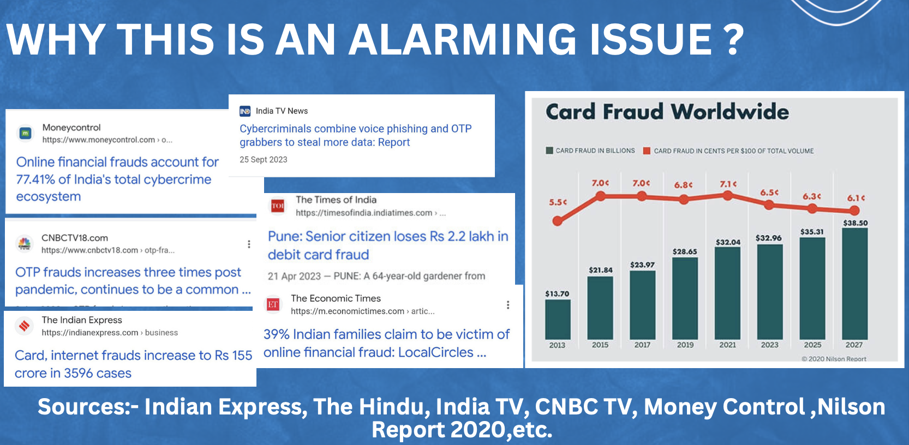
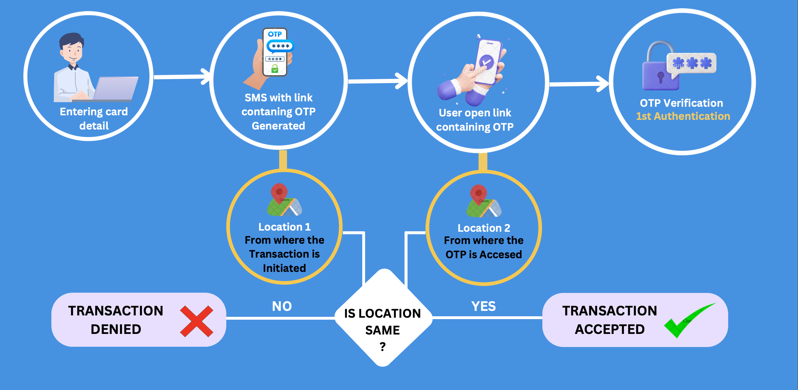

# 🛡️ Geo-OTP Based Online Transaction Fraud Prevention System

An E-Commerce & FinTech security solution (**BookVault India**) designed to protect users from online card and OTP phishing fraud by combining **Two-Step SMS Weblink OTP Authentication** with **Real-Time W3C Hardware Geolocation Proximity Verification**.

---

## 📌 Problem Statement

Traditional One-Time Password (OTP) verification is vulnerable to **social engineering, phishing, vishing (voice phishing), and remote screen-sharing scams**. In a typical attack:
1. A fraudster sitting in a remote city initiates an online card transaction on their computer using stolen card details.
2. An SMS containing the plain-text OTP arrives on the victim's phone.
3. The fraudster tricks the victim into reading out the OTP over a phone call or entering it on a fake webpage.
4. Because standard payment gateways only check whether the OTP number matches—without verifying **where** the OTP was accessed relative to **where** the transaction was initiated—the fraudulent transaction succeeds.



---

## 💡 Proposed Approach & How It Works

Instead of sending a plain-text OTP directly inside the SMS body, our system sends a **secure verification web link** to the user's registered mobile number and enforces a **physical proximity check** between the transaction device (Laptop) and the authentication device (Mobile Phone).



### Step-by-Step Workflow:
1. **Product Checkout (`/`) & Card Entry (`/payment`)**:
   - The user selects a book on **BookVault India** and enters their card details on their laptop.
   - A 4-digit OTP is generated and stored in **Firebase Cloud Firestore** (`otpcollector` collection) with an official Google server timestamp (`serverTimestamp()`).
   - The **Node.js + Express** backend calls the **Twilio SMS API** to send a secure verification link (`https://otp-based-fraud.web.app/otp`) to the user's registered mobile number.
2. **Capturing Location 1 (Laptop Geolocation)**:
   - On the `/pin` verification screen, the laptop browser captures **Location 1** ($\text{lat}_1, \text{lon}_1$) where the payment was initiated using the W3C Hardware/Wi-Fi Geolocation API.
3. **Capturing Location 2 (Mobile Phone Geolocation via SMS Link)**:
   - The user taps the SMS link on their mobile phone.
   - The mobile verification page (`/otp`) captures **Location 2** ($\text{lat}_2, \text{lon}_2$) from the phone's GPS, stores it in **Firebase Cloud Firestore** (`locations` collection), and **only then** unlocks and reveals the **4-digit OTP** on the phone screen.
4. **Haversine Distance & OTP Verification (`/pin` $\rightarrow$ `/result`)**:
   - When the user enters the 4-digit OTP on the laptop, the system fetches the phone's coordinates from Firestore and computes the real-world distance ($d$) between the laptop and the phone using the **Haversine Formula**:
     $$a = \sin^2\left(\frac{\Delta\text{lat}}{2}\right) + \cos(\text{lat}_1)\cdot\cos(\text{lat}_2)\cdot\sin^2\left(\frac{\Delta\text{lon}}{2}\right)$$
     $$d = 2 \cdot R \cdot \arcsin(\sqrt{a}) \quad (R = 6371\text{ km})$$
   - **Decision Rule**:
     - ✅ **Transaction Accepted**: If $\text{Entered OTP} == \text{Generated OTP}$ **AND** $\text{Distance } d \le \text{Allowed Security Zone}$.
     - ❌ **Transaction Denied (Fraud Alert)**: If the OTP is incorrect **OR** the phone and laptop are outside the allowed security radius (even if a remote scammer enters the correct OTP!).

---

## 📍 Geolocation & Distance Calculation Methodology

### 1. Why W3C Hardware Geolocation Instead of IP-Based Geolocation?
- **No IP Lookup Fallbacks**: IP-based geolocation only identifies an ISP's network hub or city and can be easily spoofed using a VPN. Therefore, this system **strictly uses the W3C Geolocation API (`navigator.geolocation`)** and never falls back to IP-based location.
- **Two-Stage Sensor Acquisition**:
  1. **Stage 1 (High-Accuracy Hardware GPS)**: Requests `{ enableHighAccuracy: true, timeout: 8000, maximumAge: 0 }` to acquire fresh satellite GPS coordinates (`maximumAge: 0` prevents cached readings).
  2. **Stage 2 (Indoor Wi-Fi / Cellular Triangulation)**: If satellite line-of-sight is unavailable indoors, it falls back to W3C Wi-Fi/Cell triangulation (`enableHighAccuracy: false, maximumAge: 0`).
- **Fail-Closed Enforcement**: If location permission is denied on either the phone or the laptop, the OTP remains locked (`••••`) and the transaction is blocked.

### 2. Why the Haversine Formula?
| Algorithm | How It Works | Suitability for Geo-OTP Fraud Prevention |
| :--- | :--- | :--- |
| **Euclidean Distance** | Treats Earth as a flat 2D plane | ❌ Inaccurate due to Earth's curvature. |
| **Spherical Law of Cosines** | Uses $\arccos(\dots)$ on a sphere | ⚠️ Suffers from floating-point rounding errors at very short distances (`10m`–`100m`). |
| **Haversine Formula *(Used)*** | Uses $\sin^2(\Delta/2)$ on a sphere ($R = 6371\text{ km}$) | ✅ **Industry Standard**: Fast ($<1\text{ ms}$), zero external API cost, and numerically stable even at `1m`–`100m`. |
| **Vincenty's Formula** | Oblate ellipsoid model | ⚙️ Overkill for short proximity radii with no practical difference under 20 km. |

---

## 🖥️ Transaction Results & Screenshots

### 1. ✅ Payment Successful (Matching OTP + Devices Within Security Zone)
When the user opens the SMS link on their phone next to their laptop (e.g., `10 m (0.010 km)` apart) and enters the valid OTP, the transaction is verified and approved:


---

### 2. ❌ Payment Blocked — Fraud Alert (Distance Exceeded / Remote Attacker)
Even when the **correct OTP** is entered (`✓ Correct OTP`), if the distance between the laptop initiating the payment and the phone opening the OTP link exceeds the security zone, the system immediately blocks the transaction:


---

## 🛠️ Tech Stack

| Layer | Technology |
| :--- | :--- |
| **Frontend** | React 18 (`.jsx`), Vite, React Router v6, Styled Components |
| **Backend** | Node.js, Express.js, CORS, Dotenv |
| **Database & Hosting** | Firebase Cloud Firestore, Firebase Hosting (`otp-based-fraud.web.app`), Vercel |
| **SMS Gateway** | Twilio Programmable Messaging REST API |
| **Security & Geolocation** | W3C HTML5 Geolocation API (`navigator.geolocation`), Haversine Distance Algorithm |

---

## 📂 Project Structure

```text
otp_based_fraud_prevention_secure-master/
├── frontend/                   # React + Vite Frontend Application
│   ├── index.html              # App Entry HTML
│   └── src/
│       ├── index.jsx           # React Router Setup (/, /payment, /pin, /otp, /result)
│       ├── App.jsx             # BookVault India Storefront & Search
│       ├── ProductList.jsx     # Catalog of Bestselling Books (₹ INR)
│       ├── Product.jsx         # Book Card Component
│       ├── PaymentForm.jsx     # Interactive Card Checkout & OTP Trigger
│       ├── PinPage.jsx         # Laptop Geo-OTP Verification & Haversine Check
│       ├── MobileOtp.jsx       # Mobile Phone GPS Capture & OTP Display Page
│       ├── Result.jsx          # Transaction Receipt & Fraud Status Page
│       ├── firebaseconfig.js   # Firebase App & Firestore Initialization
│       ├── StoreData.js        # Stores Generated OTP in Firestore (otpcollector)
│       ├── ReadOtp.js          # Reads Latest OTP from Firestore
│       └── ReadLatestData.js   # Reads Latest Mobile GPS Coordinates from Firestore (locations)
│
├── backend/                    # Node.js + Express Backend Server
│   ├── server.js               # Express Server & Twilio SMS Dispatch Endpoint (/send-message)
│   └── .env                    # Environment Variables (Twilio Credentials & Port)
│
├── public/                     # Static Assets, Diagrams & Screenshots
│   ├── success.gif             # Success Animation
│   ├── failure.gif             # Fraud Alert Animation
│   ├── working.png             # System Architecture Diagram
│   ├── report.png              # Fraud Statistics Report
│   ├── succes payment.png      # Verified Transaction Screenshot
│   └── fail payment.png        # Blocked Transaction Screenshot
│
├── .gitignore                  # Ignored Files (node_modules, .env, build artifacts)
├── vercel.json                 # Vercel Full-Stack Deployment Configuration
├── vite.config.js              # Vite Configuration
├── package.json                # Project Dependencies & Scripts
└── README.md                   # Project Documentation
```

---

## 🚀 Getting Started (How to Run Locally)

### 1. Install Dependencies
```bash
npm install
```

### 2. Configure Environment Variables
Create a `backend/.env` file with your Twilio credentials:
```env
TWILIO_ACCOUNT_SID=your_twilio_account_sid
TWILIO_AUTH_TOKEN=your_twilio_auth_token
TWILIO_PHONE_NUMBER=+1xxxxxxxxxx
PORT=8000
```

### 3. Configure Firebase Firestore
Update [`frontend/src/firebaseconfig.js`](./frontend/src/firebaseconfig.js) with your Firebase project configuration and enable **Cloud Firestore** in your Firebase Console.

### 4. Run the Project (Open 2 Terminals)

**Terminal 1 — Start the Frontend (Vite on Port `3000`):**
```bash
npm run dev
```

**Terminal 2 — Start the Backend (Express on Port `8000`):**
```bash
npm run server
```

Open **http://localhost:3000/** in your browser to use the application!

---

## ☁️ Deploying to Vercel

This project includes [`vercel.json`](./vercel.json) to deploy both the React frontend and Express backend together:
1. Push the repository to GitHub.
2. Import the repository on [Vercel](https://vercel.com).
3. Add `TWILIO_ACCOUNT_SID`, `TWILIO_AUTH_TOKEN`, and `TWILIO_PHONE_NUMBER` under **Environment Variables**.
4. Click **Deploy**.
